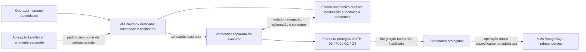

# AUTH-BOOT-02-R1 — Especificação substituta proposta

**Estado: PROPOSTA — NÃO APROVADA — NÃO IMPLEMENTADA**

Documento preparado em progbox no âmbito DEV-10-AUTHBOOT02-R1-DRAFT.
Não autoriza implementação, provisionamento, builds, serviços, SQL, migrações,
alteração de manifestos ou abertura de AUTH-03/F02/G2/G4. Não é uma aprovação
assinada nem um formato aceite por qualquer executor existente.

## A. Identidade e proveniência

Identificador: **AUTH-BOOT-02-R1**. Revisão documental: **R1-DRAFT-1**.
O contrato original AUTH-BOOT-02 não foi localizado. Esta é uma **nova proposta
substituta**, não uma recuperação ou transcrição do original perdido.

Classificações usadas neste documento:

- **FACTO:** observado e verificável na baseline ou nas fontes identificadas.
- **DETERMINAÇÃO HUMANA ATUAL:** limite expresso no pedido desta tarefa.
- **REFERÊNCIA I2:** requisito recuperado de um pedido humano que declara essas
  decisões aprovadas; não estabelece equivalência normativa com AUTH-BOOT-02.
- **PROPOSTA R1:** escolha nova, incluindo todos os formatos, interfaces, estados,
  limiares e mecanismos abaixo; exige decisão humana posterior.

### Fontes

| Ref. | Fonte verificável | Atribuição e limite |
| --- | --- | --- |
| H-R1 | Pedido DEV-10-AUTHBOOT02-R1-DRAFT, anexo `8d03f69f-ee14-4161-8ff5-2a74eb1c8319/Pasted text.txt`, §§1–6 | Autoriza apenas este documento e determina VM Proxmox dedicada à autoridade, separada da aplicação e das VMs PostgreSQL. Não aprova as decisões técnicas R1-D01–D10. |
| H-I2 | Pedido G4-HO2-I2-PREFLIGHT, anexo `aedd3ea8-5de5-433c-a5c9-bbbd8c3427ff/Pasted text.txt`, linhas 48–87 | Enuncia I2-D02/D03 como aprovadas. SHA256 `795ef6000745493a6c5a91f6b1116ff6170b9e7eecf200385165a199cabd830b`. Sem data expressa; fora do Git. |
| H-AUDIT | Pedido I2-S01-AUDIT, anexo `deb81a29-e48f-4bb4-a3a1-db597653dc5a/Pasted text.txt`, linhas 42–50 | Corrobora as decisões I2; não contém o contrato original AUTH-BOOT-02. |
| S-DEC | `docs/architecture/decision-register.md:237–271` | Referência secundária com originais SOURCE_NOT_LOCATED; não permite fabricar schemas F03/F04 nem encerrar as lacunas G4/L02. |
| S-AUTH03 | `docs/specifications/f0/auth03-alembic-executor.md:147–166` | Verificador externo futuro, vínculo contextual, uso único e tratamento de commit incerto; não implementa a autoridade. |
| S-F02 | `scripts/postgres/g4/contracts.py:417–502` | Referências não autenticadas e fronteira de execução sempre recusada; objetos Python não são capacidades. |
| S-ATTEST | `docs/operations/dev09-attest03-reconciliation.md` | Fontes aprovadas, aplicação e validação offline separadas de autorização operacional. SHA256 `afb4581cf2e99b5c4429ba39ee618be7ae1455485557041687da0498fc544481`. |

Os anexos são os fornecidos nesta conversa, sob `/home/paulo/.codex/attachments/`;
não fazem parte de um checkout reproduzível. A investigação DEV-10 consultou 37
commits locais acessíveis por referências/reflogs e não encontrou o original.
Isso delimita a pesquisa local, não prova inexistência noutras fontes.

### Baseline anterior à criação deste documento

Branch `main`; HEAD `647179c928888adfeef0f69f582fd13c5fc17350`; índice SHA256
`50d32095da16e2c0e985226625971e890c33d406cbb9b97743a7198905b9541e`.
333 ficheiros não ignorados inventariados; alterações locais preexistentes
preservadas. AUTH-03 válido 52/52, manifesto
`4819c697b7d12f7ab5cbb1fdfa9cf4c3fd0e98e93b53a60337296cc84036fc29`;
APP-04 7/7; F02/G2/G4 fechados.

| Fonte de baseline | SHA256 confirmado |
| --- | --- |
| `compose.auth03-executor.yaml` | `4e2a634568b568bc9402a44f74d05221ee3d2f022fe221b0d9535f007bb49fa7` |
| `scripts/postgres/auth03_executor.Dockerfile` | `666da86b54e81f0b7196eef55fac8d54ddfaab31c9f98e6d99727bb78c30b7b0` |
| `scripts/postgres/auth03_executor.Dockerfile.dockerignore` | `6920490db9bcbfd0ee1c5710a10758187f45fa5b141d3c4d4842fa9a587d6794` |
| `scripts/dedicated/dev09fix01_packaging.py` | `0d525bbadc8533a94a9650220b8361bb06c983533383740c91c5a67212a0bc17` |
| `backend/tests/test_dev09fix01_packaging.py` | `b623d6f138db6950f5c10f3e0d2bdfaf73a49b9a57846c32be90b22acf739a0f` |
| `scripts/dedicated/dev09a2_packaging.py` | `36492ed081807b235d179a09cbf894b8ffd2d30ca403c83a9e8364a56fcb0e5c` |
| `backend/tests/test_dev09a2_integration.py` | `fe3d071f7e9d0d238d7e060a4ebaf33d4a21931fda7b408f49008ce22afb744c` |

## B. Objetivos e fronteiras de confiança

**PROPOSTA R1:** a autoridade converte uma decisão humana autenticada numa
aprovação contextual e verificável. Não executa migrações, não possui privilégios
administrativos das bases LiveNet e não delega a decisão humana na aplicação.

Separar quatro responsabilidades: avaliar/emitir, verificar, gerir o estado
autoritativo de reclamação/consumo e executar uma operação protegida. Podem
partilhar alguns componentes na VM da autoridade, após revisão, mas não uma
identidade ou privilégio que elimine as fronteiras. O executor não pode emitir
aprovações, alterar confiança/revogação ou converter uma recusa em aceitação.

Posse de mensagem, assinatura válida, ficheiro de configuração, nome de operador,
digest coincidente ou resultado offline positivo são condições insuficientes.
Exigir simultaneamente política válida, solicitante autenticado, contexto exato,
estado atual consultável, consumo autorizado e todos os gates aplicáveis.
Erro, ausência, ambiguidade ou dependência indisponível implica BLOCKED antes de
novos efeitos protegidos. Não existe alternativa local, chave de emergência no
executor, booleano de ativação ou aprovação sintética de contingência.

## C. Topologia aprovada como limite desta preparação

**DETERMINAÇÃO HUMANA ATUAL:** autoridade numa VM Proxmox dedicada, separada da
aplicação LiveNet e das VMs PostgreSQL. A determinação aprova essa separação
conceptual; não provisiona a VM nem aprova a configuração operacional.

O diagrama é conceptual, não um percurso executável. A localização concreta do
verificador e da persistência exige decisão; o verificador não implica nova VM
por si só. Não são atribuídos nomes definitivos de VMs, IPs, VLANs, portas,
recursos, endpoints ou identidades reais. A política interna DEV-05A-D01 continua
aplicável; a palavra externa significa exterior ao executor, não acesso Internet.

## D. Identidade e confiança

**REFERÊNCIA I2-D02:** identidade e permissões verificadas, confiança independente,
Ed25519 e chave privada fora do harness G4.

**PROPOSTAS R1-D01/D07:**

- Identificadores imutáveis de autoridade e chave, associados a chaves públicas e
  âmbitos por um registo de confiança aprovado fora da aplicação/executor.
- Não aceitar como raiz uma chave transportada pela própria aprovação, URL
  arbitrário, DNS isolado ou primeira chave observada. Certificado de transporte
  e chave de assinatura são identidades distintas.
- Distribuição inicial e alterações de confiança por procedimento independente,
  autenticado, revisto e auditado. O emissor não altera sozinho a política que
  permite confiar nele; credenciais da aplicação não administram esse registo.
- Separar chaves de emissão online de eventual raiz de gestão offline. Preferir
  chave de emissão não exportável se a solução aprovada o permitir; alternativa
  software cifrada com permissões mínimas tem menor resistência ao compromisso
  do host. Hardware, PKI e cerimónia de custódia permanecem por selecionar.
- Rotação com IDs novos e períodos explícitos. Manter material público histórico
  para auditoria não permite reutilizar aprovações consumidas ou expiradas.
- Revogar por aprovação, chave ou autoridade. Compromisso implica bloquear novas
  reclamações/consumos afetados e investigar tentativas já iniciadas.
- Substituição de autoridade exige nova decisão humana, novo vínculo de confiança
  e continuidade demonstrada do histórico de consumo/revogação. Não restaurar
  uma chave antiga ou um snapshot e presumir continuidade.

## E. Aprovações assinadas

### E.1 Requisitos I2 recuperados

H-I2 atribui a I2-D02: aprovação humana externa, Ed25519, chave privada fora do
harness, política independente, vínculo ao digest global, ambiente, geração da
VM, operação, gate, finalidade e validade; verificação fail-closed. I2-D03 refere
máximo inicial de 15 minutos, intervalo `not_before <= now < expires_at`, relógio
confiável, revogação autenticada e resistente a rollback, tentativa concreta,
reclamação atómica e uso único. Resultado incerto bloqueia e não permite
reutilização automática. Estes requisitos são **referências para R1**, não prova
de equivalência histórica com AUTH-BOOT-02.

### E.2 Formato candidato — decisão R1-D02 PENDENTE

Propor envelope JSON fechado com apenas `payload` e `signature_hex`. O payload
teria exatamente os campos seguintes; não é schema implementado nem formato
aceite pelos gates atuais:

| Grupo | Campos candidatos e vínculo |
| --- | --- |
| Protocolo | `protocol_version`, `signature_algorithm`: valores únicos da revisão aprovada; recusar negociação ou algoritmo desconhecido. |
| Autoridade | `issuer_id`, `key_id`, `trust_policy_version`: selecionam confiança previamente instalada, nunca fornecida implicitamente pelo token. |
| Rastreabilidade | `approval_id`, `request_id`, `attempt_id`: IDs distintos, únicos e vinculados a um pedido e tentativa; `approver_id` identifica a decisão humana autenticada. |
| Participantes | `requester_id`, `executor_id`, `audience`: identidades autenticadas e autorizadas, não rótulos autodeclarados. |
| Contexto | `environment`, `vm_generation_id`, `target_binding_sha256`, `global_digest_sha256`: expectativas aprovadas antes das observações operacionais. |
| Efeito | `operation`, `gate`, `purpose`, `execution_plan_sha256`: um efeito e plano exatos; sem wildcards, head, stamp ou expansão implícita para outra cadeia. |
| Tempo e estado | `issued_at`, `not_before`, `expires_at`, `authority_epoch`, `revocation_epoch`: validade e versões verificáveis contra estado externo atual. |

Propor IDs de pedido/aprovação/tentativa em UUID textual canónico, identificadores
de catálogo ASCII limitados e digests SHA256 em 64 hexadecimais minúsculos.
Tempos seriam strings UTC com segundos inteiros e forma única; versões/epochs
seriam strings decimais sem zeros iniciais. Não usar números JSON, floats,
normalização Unicode implícita, campos livres, credenciais ou dados de execução
sensíveis. IDs e limites exatos carecem de aprovação R1-D02.

O vínculo de destino deverá abranger identidades física e lógica, geração,
base/cluster, revisão de origem/destino, perfil e artefactos efetivos. O catálogo
fechado de operações e a codificação desse vínculo/plano são dependências ainda
pendentes; não serializar objetos F02 por `repr`, inventar os schemas F03/F04 ou
preencher expectativas a partir do destino observado. O digest global tem de
identificar o candidato integral revisto; a relação entre esse digest e o bundle
AUTH-03 deve ser especificada, não presumida como igualdade.

### E.3 Bytes assinados e validação candidata

Propor JCS/UTF-8 como canonicalização do payload. A [RFC 8785](https://www.rfc-editor.org/rfc/rfc8785.html)
descreve JCS com serialização determinística e ordenação de propriedades; não
basta usar um serializador JSON comum com ordenação de chaves. O perfil fechado
R1, mais restrito, é escolha nova. Rejeitar duplicados no parse, Unicode inválido,
tipos/campos desconhecidos e entradas acima dos limites antes de canonicalizar.

Propor assinar com Ed25519 puro os bytes: prefixo ASCII fixo
`LiveNet/AUTH-BOOT-02-R1/approval/v1`, um byte NUL e o payload JCS em UTF-8.
Este enquadramento e separação de domínio são **novos e pendentes**; não são
G4-WF1 nem declaração de compatibilidade com F03/F04. Não intercambiar Ed25519,
Ed25519ctx e Ed25519ph. A [RFC 8032](https://www.rfc-editor.org/rfc/rfc8032.html)
é referência do algoritmo e dos seus vetores de teste, não aprovação de R1.

Propor assinatura hexadecimal minúscula com comprimento fixo de 128 caracteres;
payload limitado a 16 KiB e profundidade máxima de oito níveis. Esses limites
também são PENDENTES. Verificação valida comprimentos, schema, canonicalização,
assinatura com chave de confiança, política, participantes e contexto completo.
Uma assinatura válida nunca dispensa consulta atual a revogação/consumo nem
torna o executor operacional. Não há exemplo com material real de chaves.

## F. Ciclo de vida da autorização

Todos os estados e transições seguintes são **PROPOSTA R1-D04/D06**, sem alterar
enums F02. Distinguir validade temporal, revogação e estado de execução.

| Fase | Comportamento candidato |
| --- | --- |
| 1. Pedido | Solicitante autenticado submete contexto e plano fixos; atribuir request/attempt IDs. Pedido não autoriza efeitos. |
| 2. Avaliação humana | Apresentar destino, digests, operação, riscos e janela; rejeitar contexto incompleto. Aprovação exige ação humana autenticada; não preselecionada. |
| 3. Emissão | Verificar política e competência do aprovador, gravar decisão durável e assinar o candidato exato. Se não for possível registar a emissão, não emitir. |
| 4. Entrega | Canal protegido e destinatário autenticado. Reenvio da mesma mensagem é apenas entrega, não nova autorização. |
| 5. Verificação | Validar assinatura, confiança, finalidade, identidades, digests, tempo e estado externo fresco. Bloquear divergência ou indisponibilidade. |
| 6. Reclamação atómica | No estado autoritativo, transição condicional de ISSUED para CLAIMED para um único attempt/requester/executor/contexto. Duas réplicas não podem vencer. |
| 7. Consumo | Transição durável CLAIMED para CONSUMED_FOR_ATTEMPT antes do primeiro efeito protegido; revalidar revogação/tempo/política e vínculo numa operação condicional atómica. Não confundir o claim com permissão para executar. |
| 8. Auditoria e resultado | Registar decisões e estados; só marcar SUCCEEDED/FAILED_VERIFIED após evidência independente apropriada. Uma falha de comunicação pode exigir UNKNOWN/BLOCKED. |
| 9. Expiração/revogação | Impedir novas transições autorizadoras. Expirar ou revogar não apaga consumo nem desfaz efeitos já iniciados. |

Recomendação inicial: nenhuma reclamação é automaticamente libertada para
reutilização, mesmo que uma lease ou ligação expire. Uma queda depois do claim
pode sacrificar disponibilidade, mas não permite que outro executor assuma a
aprovação. Repetir uma consulta pode devolver o estado já persistido; nunca
devolver uma segunda permissão de execução. IDs iguais com conteúdo diferente
são conflito, não idempotência.

O consumo de autorização e os efeitos PostgreSQL vivem em domínios distintos.
Não se promete atomicidade entre eles nem execução exatamente uma vez. Se houver
consumo sem execução, a aprovação pode ficar inutilizada; se houver execução sem
confirmação do resultado, fica bloqueada para reconciliação. Nenhum retry de
migração é derivado de timeout, ausência de recibo ou expiração de claim.

Revalidar imediatamente antes de iniciar; se expiração/revogação ocorrer após o
início, não iniciar novos passos autorizadores. O tratamento da operação já em
curso deve obedecer ao contrato transacional e de cancelamento aprovado, sem
prometer paragem instantânea ou rollback de commit confirmado. Esse ponto é
critério obrigatório de R1-D05/D08, não uma exceção automática à validade.

## G. Persistência e recuperação

### G.1 Alternativas — nenhuma tecnologia selecionada

| Alternativa | Vantagens | Riscos / condições |
| --- | --- | --- |
| Base transacional local na VM da autoridade, por exemplo SQLite | Menos componentes; transações condicionais e unicidade num único escritor. | Falha da VM afeta o estado; durabilidade, bloqueios, fsync e restauro precisam de ensaio. Snapshot pode reverter consumo/revogação. |
| Serviço transacional dedicado à autoridade, por exemplo PostgreSQL separado dos dados LiveNet | Controlo de concorrência e ferramentas de recuperação; possível separação administrativa. | Mais infraestrutura e credenciais; requer isolamento, consistência e recuperação próprios. Não reutilizar automaticamente bases, roles ou VMs operacionais existentes. |
| Ledger append-only com índice/CAS ou serviço de consenso | Pode apoiar testemunho independente e coordenação entre réplicas. | Log isolado não garante reclamação atómica; índice, quorum e recuperação são complexos e exigem especificação. |

**Recomendação PENDENTE:** escolher armazenamento transacional com unicidade e
CAS/serialização comprovadas, sob administração exclusiva da autoridade, depois
de medir requisitos. Não escolher produto ou localização com base neste texto.
Uma cache ou Redis não persistente não é fonte de verdade de consumo.

### G.2 Invariantes propostas

- Registo durável por approval/attempt, estado, digest/contexto, política, epochs,
  identidades e transições auditáveis. Unicidade e comparação do estado anterior
  fazem parte da transação, não de um teste seguido de escrita separada.
- Consumo e revogação são monotónicos: não regressar de consumido a disponível.
  Uma lease expirada não é autorização de transferência ou reexecução.
- Revogação consultada e validada no claim e no consumo; atualização concorrente
  tem ordenação definida. Um resultado local/cache sem prova de frescura não
  permite executar. Nova emissão também consulta a política atual.
- Considerar duas formas de proteção contra rollback: testemunho/epoch durável
  independente da VM restaurável, ou mecanismo monotónico de confiança com
  reconciliação externa. Assinar um snapshot que pode ser restaurado não basta.
  Seleção e ameaça residual estão PENDENTES; sem garantia, bloquear após restauro.
- Após backup/restauro ou clonagem, não emitir nem consumir até validar epochs,
  revogações e todos os consumos posteriores ao ponto restaurado por evidência
  independente. Se não for possível, invalidar aprovações afetadas mediante
  decisão humana e permanecer bloqueado; não emitir IDs antigos novamente.
- Relógio autenticado, incerteza máxima e deteção de saltos/recuos precisam de
  política aprovada. Usar monotónico para deadlines locais não prova hora UTC.
  Propor aceitar só quando todo o intervalo de incerteza está dentro da validade,
  sem tolerância positiva após expires_at e sem ultrapassar 15 minutos.
- Resultado incerto exige inspeção por canal administrativo independente, com
  identidade/destino e efeitos confirmados. Registar reconciliação humana; nunca
  reabilitar a aprovação antiga. Nova tentativa requer novo pedido e nova decisão.

## H. Integração conceptual com LiveNet

As interfaces abaixo descrevem responsabilidades, não funções ou endpoints
implementados, e não atribuem semântica nova aos tipos existentes.

| Fronteira | Entrada / saída conceptual | Restrição |
| --- | --- | --- |
| Solicitante → autoridade | Pedido autenticado com plano/digests/identidades; estado ou recusa | Aplicação não aprova o próprio pedido; não enviar passwords, tokens de sessão ou chaves privadas. |
| Autoridade → verificador | Envelope assinado e referências de política/revogação | Chave pública confiável vem do registo independente, não do envelope. |
| Verificador → estado autoritativo | Verificar, reclamar e consumir contexto exato; resposta autenticada, vinculada ao pedido e não reutilizável | Falta de resposta, conflito ou estado desconhecido impede novos efeitos. |
| Verificador → fronteira protegida | Evidência candidata de verificações e consumo, mais contexto observado independentemente | Não é bypass nem capability aceite atualmente. Binding de sessão/ligação e transporte desta evidência exige contrato revisto. |
| AUTH-03 → eventual executor | Bundle, identidade física, origem/destino e transação conforme contrato existente | operation_gate continua bloqueado. Alteração futura exige revisão própria das fontes e respetivo manifesto. |
| F02/G2/G4 | Tipos/fronteiras, evidência de readiness e autorização futura | Não reclassificar SYNTHETIC como REAL; F02 permanece UNVERIFIED/BLOCKED. Assinatura não substitui identidade, privilégios ou evidência real. |
| DEV-09B | Eventual integração num alvo explicitamente autorizado | Sem execução até contratos, imagem, alvo concreto, recuperação e autorizações próprios estarem aprovados. |

Os estados R1 não são acrescentados silenciosamente aos enums F02. Não há novo
campo de configuração que permita abrir os gates. O digest AUTH-03 de 52 fontes,
o inventário FIX01 de 66+2 e a aprovação R1 têm funções distintas. Não consumir
este documento ou um candidato JSON como se fosse manifesto/autoridade ativos.
Preservar os percursos Alembic separados e a divergência `f066`/`f067`; esta
proposta não autoriza migração nem resolução automática dessa divergência.

## I. Segurança operacional proposta

- Identidades mínimas e separadas para solicitante, aprovador, emissor, verificador,
  armazenamento, auditoria e recuperação. O emissor não recebe privilégios de
  migrator; a aplicação/executor não recebe administração da autoridade.
- Propor transporte cifrado com validação de identidade, autenticação mútua entre
  máquinas e autenticação humana forte na aprovação. mTLS é candidato, não escolha
  aprovada; gerir separadamente confiança TLS e confiança de assinatura.
- Canais e redes internos aprovados, sem publicar na Internet; políticas de rede
  verificáveis, não inferidas apenas de DNS ou endereço privado. Egress e acesso
  administrativo devem ser aprovados separadamente.
- Segregar administração da aplicação, PostgreSQL e autoridade. Administrador
  Proxmox/host pode ultrapassar isolamento de VMs; exigir governança, acessos
  mínimos e evidência independente. VM dedicada não elimina essa ameaça.
- Auditoria append-only ou protegida contra adulteração, com cópia/testemunho
  independente. Hash encadeado local não resiste sozinho ao administrador que
  controla todo o histórico. Não registar envelopes integrais, credenciais ou
  material privado; registar IDs, digests, decisão, ator e transições necessários.
- Se a escrita durável de emissão/claim/consumo/auditoria essencial falhar,
  bloquear antes de novos efeitos. Após início, preservar estado incerto para
  recuperação; não declarar sucesso pela simples ausência de erro.
- Plano de incidente: bloquear autoridade/chave comprometida, preservar evidência,
  revogar por canal independente aprovado, avaliar tentativas em curso e recuperar
  confiança mediante nova decisão. Não automatizar kill/revoke/DDL nos alvos.
- Backups cifrados e acesso separado; ensaiar recuperação de estado e de chaves
  sem reverter epochs ou reutilizar autorizações. Retenção, RPO/RTO e custódia
  precisam de decisão; disponibilidade não justifica fallback local.
- Atualizações por artefactos revistos e fixados por hashes, com aprovação,
  compatibilidade de schema/política e rollback controlado. Rollback de software
  não pode rebaixar confiança, revogação ou estado consumido.

## J. Ameaças e falhas

| Ameaça/falha | Resposta proposta e risco residual |
| --- | --- |
| Compromisso da VM da autoridade | Bloquear emissão/consumo afetado e revogar por confiança independente. VM/chave comprometida pode produzir assinaturas válidas; separar testemunho e administração reduz, não elimina, o risco. |
| Roubo da chave privada | Revogação de key/issuer, rotação e investigação. Uma assinatura posterior não prova decisão humana legítima durante o compromisso. |
| Aprovação forjada ou algoritmo trocado | Schema fechado, algoritmo fixo, chave previamente confiável, validação criptográfica e contextual; rejeitar chave/token autodeclarados. |
| Replay | IDs vinculados a tentativa e identidade; CAS e consumo durável único. Cache local de IDs vistos é insuficiente entre réplicas ou após restauro. |
| Aprovação expirada | Intervalo e incerteza de relógio verificados antes do consumo/início; não renovar silenciosamente nem terminar a validade por tempo local arbitrário. |
| Revogação não observada | Consulta autenticada fresca, epochs e proteção anti-rollback. Se não for possível demonstrar estado atual, BLOCKED. |
| Concorrência | Um vencedor por transição autoritativa; outros bloqueados. Resultado da transação desconhecido é consultado por ID, nunca presumido como não ocorrido. |
| Falha de rede/partição | Não emitir permissão por timeout; antes de efeitos, bloquear. Depois de consumo/início, estado conservador e reconciliação independente. |
| Relógio incorreto/recuo | Deteção de incerteza/saltos, fonte confiável e bloqueio. Snapshot ou suspensão da VM exige revalidação antes de aceitar. |
| Resultado de execução incerto | Aprovação continua consumida/bloqueada; inspeção independente e decisão humana antes de nova tentativa. Não prometer exatamente uma execução. |
| Administrador privilegiado no host | Pode substituir VM, software, clock ou material em memória. Registar fronteira de confiança; controlo organizacional e testemunho externo, sem alegar proteção absoluta. |
| Digest autorizado diferente da operação real | Plano imutável, artefactos revalidados e identidade física na mesma ligação operacional prevista. Divergência ou troca posterior bloqueia; TOCTOU exige vínculo efetivo, não só comparação prévia. |
| Replay de backup/snapshot ou clone | Detetar descontinuidade de epoch/consumo/revogação; bloquear restauro até reconciliação. IDs físicos repetidos por clone não demonstram identidade exclusiva. |
| Verificador/executor comprometido | Menor privilégio e separação; nenhum documento impede código arbitrário no domínio comprometido. Exigir revisão, evidência e administração independente antes de confiar. |

## K. Critérios de aceitação para implementação futura

**Não executar estes testes nesta etapa.** Cada critério precisa de evidência
reproduzível, oráculo independente quando aplicável e aceitação humana posterior.

| ID | Critério verificável futuro |
| --- | --- |
| R1-AC01 | Vetores Ed25519 positivos/negativos, incluindo RFC 8032; corrupção de cada campo/assinatura e chave errada recusadas. |
| R1-AC02 | Vetores de canonicalização independentes; duplicados, tipos/campos extra, Unicode inválido, comprimentos e versão desconhecida recusados antes de efeitos. |
| R1-AC03 | Alterar isoladamente ambiente, geração VM, destino, bundle/global digest, plano, origem/destino Alembic, operação, gate, finalidade, audience ou participantes provoca recusa. |
| R1-AC04 | Revogar approval/key/issuer antes de claim ou consumo bloqueia; testar corridas de revogação, estado antigo, cache e rollback. Documentar limite após início da operação. |
| R1-AC05 | Reclamações/consumos concorrentes por múltiplos processos/réplicas resultam num único vencedor; reenvio e lease expirada nunca geram segunda execução. |
| R1-AC06 | Falhas de rede, autoridade, armazenamento, confiança, auditoria ou relógio bloqueiam novos efeitos sem recorrer a alternativa local. |
| R1-AC07 | Quedas antes/depois de persistir emissão, claim, consumo e resultado são recuperadas sem reutilização; testar commit com acknowledgement perdido e preservar UNKNOWN. |
| R1-AC08 | Restauro/clone/snapshot não reativa aprovações ou chaves revogadas; testemunho/epoch externo indisponível impede operação. Demonstrar RPO/RTO aprovados. |
| R1-AC09 | Verificar segregação real das VMs, identidades, redes e privilégios. Aplicação/harness não lê chave privada, não altera confiança e não administra estado de consumo. |
| R1-AC10 | Um envelope válido continua incapaz de abrir os gates atuais. Integração futura exige teste independente de cada gate e revisão explícita dos contratos/fontes alterados. |
| R1-AC11 | Auditoria permite ligar decisão humana, pedido, plano, consumo e resultado sem expor segredos; retenção, integridade e acesso são verificados. |
| R1-AC12 | Revisão de ameaça, cerimónia de chaves, rotação, incidente e atualização/rollback aprovadas; nenhuma passagem de teste substitui autorização operacional. |

## L. Decisões humanas pendentes

**Todas as decisões novas abaixo estão PENDENTES.** Recomendações são propostas,
não aprovações. A separação em VM dedicada já determinada em H-R1 não decide
identidade, produto, recursos, configuração ou operação dessa VM.

| ID | Decisão e alternativas | Vantagens / riscos | Recomendação fundamentada | Estado |
| --- | --- | --- | --- | --- |
| R1-D01 | Identidade e raiz: registo independente versionado, raiz administrativa offline ou PKI dedicada. Não aceitar confiança autodeclarada. | Registo explícito é auditável; raiz offline reduz exposição mas exige cerimónia; PKI aumenta operação e não resolve sozinha permissões. | Aprovar registo independente de emissores/chaves/âmbitos e gestão separada; selecionar a tecnologia após rever recuperação e governança. | PENDENTE |
| R1-D02 | Formato: envelope fechado JCS/Ed25519 proposto versus formato padronizado revisto com perfil igualmente restrito. | JCS facilita comparação dos dados mas exige implementação exata; outros formatos reduzem desenho próprio mas podem introduzir negociação/extensões. | Rever E.2/E.3 e vetores independentes antes de fixar bytes, limites, IDs e binding F02/F03/F04. Não declarar equivalência histórica. | PENDENTE |
| R1-D03 | Transporte: serviço interno com autenticação mútua versus entrega assinada controlada e verificação online do estado. | Serviço permite frescura/consumo; exige disponibilidade e gestão TLS. Entrega desacoplada reduz ligação na emissão, mas não elimina consulta de revogação/consumo. | Canal interno cifrado e mutuamente autenticado para máquinas, aprovação humana autenticada; escolher protocolo/endpoints sem fallback offline autorizador. | PENDENTE |
| R1-D04 | Persistência/uso único: base local transacional, serviço transacional dedicado ou ledger com CAS/consenso. | Menos componentes versus maior disponibilidade; snapshots, concorrência e complexidade permanecem riscos específicos. | Selecionar por durabilidade e unicidade demonstradas; consumo antes de efeitos, sem retorno automático a disponível. Produto/localização não selecionados. | PENDENTE |
| R1-D05 | Revogação/relógio: consulta fresca com epoch/testemunho independente versus snapshots autenticados com frescura e monotonicidade demonstradas; fonte temporal autenticada a selecionar. | Consulta reduz staleness mas depende da rede; snapshots melhoram leitura mas elevam risco de rollback e janela de revogação. | Começar por verificação fresca fail-closed e limite explícito de incerteza, sem grace period que exceda validade; especificar corridas e operações já iniciadas. | PENDENTE |
| R1-D06 | Recuperação incerta: reconciliação humana com inspeção independente versus automação limitada de diagnóstico. | Intervenção é mais lenta mas evita reexecução; automação pode recolher evidência sem determinar sozinha um sucesso não comprovado. | Manter consumo, bloquear novas tentativas e exigir decisão humana para novo pedido; automatizar apenas diagnóstico posteriormente autorizado. | PENDENTE |
| R1-D07 | Custódia/rotação: hardware não exportável, raiz offline + chave online, ou chave software protegida. | Hardware reduz extração mas tem custos/dependências; software é simples mas vulnerável ao host; raiz offline exige operação disciplinada. | Preferir isolamento de chave e separação da raiz/gestão, se viáveis; definir cerimónia, revogação de emergência e recuperação antes de selecionar fornecedor. | PENDENTE |
| R1-D08 | Integração: verificador independente com interface restrita versus biblioteca junto do executor com fronteira de processo/identidade demonstrada. | Serviço separa privilégios mas acrescenta transporte; biblioteca simplifica chamadas mas facilita confusão entre validação e autoridade. | Preferir separação verificável e evidência vinculada à tentativa; qualquer abertura de gate ou alteração de manifesto requer tarefa e aprovação próprias. | PENDENTE |
| R1-D09 | Auditoria/retenção: registo transacional + exportação protegida, armazenamento imutável ou testemunho independente. | Correlação local é simples mas pode ser reescrita pelo administrador; cópia independente melhora deteção e exige política de acesso/retenção. | Auditar transições duráveis e manter evidência independente minimizada; escolher retenção e responsabilidades sem incluir envelopes/segredos completos nos logs. | PENDENTE |
| R1-D10 | Operação/recuperação da VM dedicada: instância única fail-closed com restauro ensaiado versus redundância futura explicitamente aprovada. | Instância única reduz complexidade mas é ponto de indisponibilidade; redundância exige coordenação e prevenção de split-brain/replay. | Começar por plano verificável de backup/restauro, epochs e RPO/RTO; aprovar recursos/redes e eventual HA separadamente, sem provisionar nesta etapa. | PENDENTE |

### Condições para a próxima etapa

Submeter R1-D01–D10 a revisão humana, resolver as lacunas de binding/canonicalização
e rever a proposta resultante como conjunto coerente. Uma aprovação documental
não autoriza por si só implementar, construir, instalar, provisionar ou executar.
Cada etapa posterior exige âmbito e autorização próprios. Nenhuma fonte histórica
é substituída por este draft, nenhum gate é aberto e DEV-09B não é iniciada.
